<p align="center">
  
</p>

<p align="center">
  <a href="mailto:saadshakir2300@gmail.com"></a>
  <a href="https://brightstack.pk"></a>
  </p>

<br/>

## ⚡ About me

```ts
const saad = {
  role:      "Full-Stack Engineer",
  education: "BS Computer Science · MUST (CGPA 3.4)",
  research:  "Research Assistant @ CHISEL Lab, LUMS — HCI, accessibility & GenAI",
  worked_at: ["NetSol Technologies", "Shark Stack"],
  building:  "Brightstack — SaaS for retail & education (co-founder)",
  teaching:  "Evening CS classes for intermediate students",
  loves:     ["real-time systems", "LLM products", "clean APIs"],
};
```

## 🧰 Tech stack

<p align="left">
  
  <br/>
  
</p>

<sub>Also: Socket.IO · React Native / Expo · Groq (Llama 3) · Whisper STT · REST & WebSocket APIs</sub>

## 🚀 Featured work

<table>
  <tr>
    <td width="50%" valign="top">
      <h3><a href="https://github.com/Saadshakir149/LLM_MODERATOR">🤖 LLM Moderator</a></h3>
      Real-time platform where an LLM moderates group discussions — used in research on active vs. passive AI moderation, with a voice mode.
      <br/><br/>
      <code>Python</code> <code>Flask-SocketIO</code> <code>React</code> <code>Groq</code> <code>Whisper</code>
    </td>
    <td width="50%" valign="top">
      <h3><a href="https://github.com/Saadshakir149/brightstack-pos">🧾 Brightstack POS</a></h3>
      Retail point-of-sale SaaS for small businesses — part of the Brightstack product line.
      <br/><br/>
      <code>TypeScript</code> <code>SaaS</code>
    </td>
  </tr>
  <tr>
    <td width="50%" valign="top">
      <h3><a href="https://github.com/Saadshakir149/mental-health-screening">🧠 Mental Health Screening</a></h3>
      Web app for guided mental-health screening.
      <br/><br/>
      <code>TypeScript</code>
    </td>
    <td width="50%" valign="top">
      <h3><a href="https://github.com/Saadshakir149/ai-evaluator">📐 AI Evaluator</a></h3>
      LLM-based evaluation tool.
      <br/><br/>
      <code>Python</code> <code>LLMs</code>
    </td>
  </tr>
  <tr>
    <td width="50%" valign="top">
      <h3><a href="https://github.com/Saadshakir149/user-auth-rbac-api">🔐 Auth & RBAC API</a></h3>
      Production-style authentication with JWT and role-based access control.
      <br/><br/>
      <code>Node.js</code> <code>Express</code>
    </td>
    <td width="50%" valign="top">
      <h3><a href="https://github.com/Saadshakir149/HalimEnterprisesLimited">🏢 Halim Enterprises</a></h3>
      Client website for a UK accountancy firm.
      <br/><br/>
      <code>TypeScript</code> <code>Client work</code>
    </td>
  </tr>
</table>

## 🤝 Let's work together

I'm open to **full-stack, backend and AI engineering roles** — remote or on-site.
Drop me a line at **saadshakir2300@gmail.com**.
